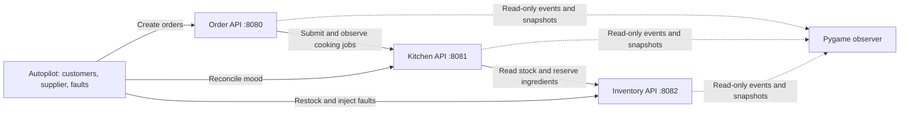

# PizzaOps service architecture and build plan

Status: implementation plan, 2026-11-06. Stages 0 to 4 are done (architecture, Inventory, Kitchen, Order, live observer) and milestone P0 passes as three real processes; see the milestone table in section 8. The autopilot and fault/mood polish are still to do.

## 1. Starting point and target

The repository already has Python 3.13, FastAPI, HTTPX, pytest, an asset pack, a working offline Pygame showcase, and ten passing asset tests. The three service directories, autopilot modules, observer feed/world modules, and P0 acceptance test are empty. `main.py` is a small FastAPI greeting application.

The target is an autonomous restaurant you watch. Customers arrive, orders enter a queue, the kitchen asks for ingredients, and the restaurant responds to real shortages and communication failures. The sprites show those outcomes; they never decide them.

Keep the existing three-service layout and local development workflow. Do not introduce Docker, Kubernetes, Kafka, Redis, PostgreSQL, user accounts, payments, or an LLM in the first version. We can add persistence after the local system works and its failure behavior is understood.



## 2. Ownership and boundaries

| Component | Owns | Does not own |
| --- | --- | --- |
| Order | Customer/order records, request deduplication, order status, trace creation, overall fulfillment tracking | Recipes, stock, kitchen moods |
| Kitchen | Recipes, cooking jobs, worker capacity, cooking result, patience, stress, trust | Authoritative stock or the final customer-facing order record |
| Inventory | Available quantities, immutable successful reservations, stock versions, restocking, injected faults | Recipes, customers, order status, personalities |
| Autopilot | Scenario seed, scheduled arrivals, customer traits, restock and fault schedule | Direct access to service dictionaries |
| Viewer | Event cursors, display state, sprite movement, authored dialogue, playback | Any command that changes business outcomes |

Services communicate over HTTP and do not import one another's implementation. Keep small infrastructure helpers local to each service, as the existing guide requests. Contract tests enforce consistency without creating a shared business-logic package.

Kitchen may store an order ID to correlate a cooking job; that is not ownership of the order record. Order can store a projection of the kitchen's reported state but may not invent cooking progress.

## 3. Recommended decisions

### Local state and deployment

Use independent in-memory stores with one Uvicorn process per service. Use async handlers and a service-local `asyncio.Lock` around related state changes. Every mutation must use that same locking boundary. Do not await network calls, injected delays, or cooking timers while holding a state lock.

Multiple Uvicorn workers are explicitly unsupported in this phase: their dictionaries and locks would not be shared. Restarting a service loses its state and changes its `instanceId`. The launcher should normally restart the whole simulation as a fresh `runId`. A mid-run service restart must be visible as a state-loss incident, not silent recovery.

### Nonblocking order submission and cooking jobs

`POST /orders` creates an order and returns `201 RECEIVED` promptly. A bounded Order queue handles fulfillment independently of new customer arrivals. Start with four Order workers and two Kitchen workers, both configurable. Set a finite backlog limit; reject admission with `503 QUEUE_FULL` before creating an accepted record when capacity is exhausted. Existing idempotent requests still return their previous record when the queue is full.

Kitchen also owns a bounded job queue. `POST /cook` returns `202` for a newly accepted job. `GET /cook/{orderId}` exposes its actual progress and final result. Order polls this endpoint rather than keeping a cooking HTTP connection open. This is a deliberate revision of the guide's synchronous `200 COOKED` endpoint: queued acceptance and completed cooking must be distinguishable.

Create clients, queues, and supervised workers in the application's lifespan. Reuse one HTTPX async client per downstream dependency. On shutdown, stop accepting new work, allow a bounded drain, then close clients and cancel remaining workers. Do not use an unsupervised task per request or treat FastAPI BackgroundTasks as a durable queue. Neither the queues nor their results survive a crash in this version.

### Recipes and atomic reservation

Kitchen owns three starting recipes:

| Pizza | Ingredients per pizza |
| --- | --- |
| CHEESE | DOUGH 1, SAUCE 1, CHEESE 1 |
| PEPPERONI | DOUGH 1, SAUCE 1, CHEESE 1, PEPPERONI 1 |
| MARINARA | DOUGH 1, SAUCE 1, BASIL 1 |

Multiply all ingredient quantities by the order quantity before reserving. Inventory accepts the complete ingredient map and either deducts everything once or deducts nothing. A cheese shortage must still allow marinara orders.

In this first version, reservation means a final allocation out of available inventory, matching the existing guide. It has no expiry, commit/release protocol, or automatic refund. If cooking subsequently fails, the allocated ingredients are accounted for as used/wasted. Do not restore stock because a client timed out. A later true hold/release design requires additional state transitions and tests; it is not hidden inside P0.

### Idempotency and uncertainty

Use `(runId, requestId)` for Order submission and `(runId, orderId)` for Kitchen jobs and successful Inventory reservations. Store the normalized request fingerprint with each accepted record. Same key and same payload returns the original record without new work; same key and different payload returns `409 IDEMPOTENCY_CONFLICT`. Check duplicates before admission limits or fault-induced pre-mutation failures.

A timeout does not prove that a request failed before taking effect. Order looks up a cooking job by its original key; Kitchen looks up a reservation by its original key. If needed, resubmit using the same key while the relevant service instance is unchanged. Never retry with a fresh key just to escape uncertainty.

Recommended Order states:

```text
RECEIVED -> CHECKING -> COOKING -> READY
               |           |
               +-----------+------> FAILED
               |           |
               +-----------+------> RECONCILING -> READY / FAILED / UNKNOWN
```

`FAILED` means a known unsuccessful result, such as an authoritative shortage. `UNKNOWN` means outcome could not be established, including state lost after a restart. It is an unresolved state and may later return to RECONCILING if evidence becomes available. It is never counted as served or definitively failed. A timeout is recorded as an incident and last error; it does not immediately become a definitive order verdict.

This revises the guide's requirement that every possible incident must end READY or FAILED. With nonpersistent services and lost responses, guaranteeing that requirement would require inventing a result. When services stay available and preserve their state, accepted orders should converge to READY or FAILED.

### Time budgets

Keep the guide's configurable two-second network budget per dependency attempt, but enforce an overall attempt deadline as well as HTTPX's connect/read/write/pool timeouts. Those phase timeouts are not an end-to-end deadline. Start with a 0.3-second connect budget and a two-second overall attempt budget.

A cooking job's deadline is separate from an HTTP attempt: propose 15 seconds, including queue time. Start with 0.25-second simulated cooking in the normal profile so an unloaded happy path can meet the guide's subsecond target. Slower scenario profiles are explicit settings.

Allow at most one immediate retry of an idempotent operation, with backoff, within its remaining deadline. After ambiguity, use status lookup and bounded reconciliation rather than unlimited mutation retries. Propose a 30-second reconciliation window with at most five lookup attempts and increasing backoff; all network attempts remain individually bounded. Once either limit is exhausted, mark UNKNOWN and report the reason. A timeout at the caller does not cancel work at the callee; job workers must check their own deadlines before starting new mutations. A mutation already in flight may still complete and requires reconciliation.

## 4. Walk through one order

1. Autopilot submits a customer, pizza choice, quantity, and stable request ID.
2. Order validates, saves RECEIVED and its event atomically, and responds with the order ID and trace ID.
3. An Order worker submits a cooking job using the same order ID and trace ID.
4. A Kitchen worker checks its capacity/mood, expands the recipe, and obtains a stock snapshot.
5. Kitchen asks Inventory to reserve the complete recipe. Inventory checks and deducts under its lock, stores the reservation, and emits an event.
6. Kitchen reports COOKING, waits for the configured cooking interval, then records COOKED. It never reports COOKED without confirmed allocation.
7. Order observes COOKED and records READY. A known rejection instead produces FAILED with a structured reason.
8. The observer consumes events and animates arrival, ingredient handling, preparation, and pickup. Animation length never delays or changes the service result.

Polling can miss short intermediate states. Order may move CHECKING directly to READY when a confirmed COOKED result is its next observation; it must not manufacture a timed COOKING period. Kitchen's own transition events and timestamps provide the detailed cooking history for the viewer.

## 5. Events, reconnects, and replay

Every state transition produces one structured record used for both logs and the event feed. Events carry schema version, run ID, service, instance ID, sequence, timestamp, trace ID, order ID, entity version, type, and payload. Sequence is strictly increasing inside a service instance; timestamps do not create a reliable global ordering.

Each service exposes `GET /events` and `GET /snapshot`. Retain a bounded ring buffer, initially 5,000 events. The client cursor includes instance ID and sequence. If a cursor is too old or refers to a previous instance, return an explicit reset response, not an incomplete successful replay. The snapshot includes its event watermark, captured with state under the same lock. Fetch it, then resume strictly after that watermark. If another retention gap occurs, resnapshot.

The viewer tracks three cursors independently, deduplicates events, and applies only newer versions of each service-owned entity. It must not treat timestamp sorting as business truth. On reconnect, snapshots restore display state; an event batch must not spawn duplicate customers or reapply stock deductions. Cross-service snapshots are not globally atomic.

Polling runs outside Pygame's render thread. A thread-safe bounded queue carries updates to the main thread, which is the only thread that touches Pygame rendering. If that queue overflows, signal a resync instead of silently losing events. Poll around 250 ms during normal operation, back off while disconnected, and keep window input responsive.

Seeded randomness reproduces the scenario's input schedule, not the exact interleaving of concurrent HTTP calls. Record the schedule and observed events to JSONL for repeatable event playback. Provide explicit live, recorded-replay, and offline-asset modes. Pausing or accelerating the viewer affects playback only; it does not claim to pause live services. Deterministic simulation tests use injected clocks and scripted faults instead of wall-clock races.

## 6. Personality and controlled failure

Start Kitchen trust at 60 and patience at 85. A confirmed stale-stock contradiction reduces trust by 25 and patience by 10, so one incident takes trust below the 50-point threshold. A successful reservation increases trust by five, capped at 100. Low-trust stock checks explicitly request authoritative data. Quiet-time recovery and cooldowns prevent a permanent spiral.

A stale response followed by a shortage can also reflect legitimate concurrent consumption. Do not penalize trust merely because reservation failed. Include `source`, `stockVersion`, and `snapshotVersion` in stock responses and authoritative shortage details; the scripted stale-stock scenario must establish that the advertised cached data was stale. Ordinary competition for the last ingredient is a shortage, not a lie.

Inventory supports explicit fault controls: a snapshot captured when stale mode is enabled, delay before mutation, 503 before mutation, and a later test-only delayed-response-after-mutation mode. Keeping those positions explicit makes timeout tests meaningful. Reservation correctness must survive every fault. All services bind to `127.0.0.1`; run and admin IDs must match the current scenario. No public deployment is planned.

Mood calculations are plain Python and independently testable. Dialogue belongs in the viewer: it selects authored lines from a reported event and mood, rather than changing the meaning of the event.

## 7. File responsibilities

Extend the current structure; do not reorganize the asset pack:

```text
services/inventory/
  main.py                 API wiring and lifespan
  models.py, errors.py     Validation and response contracts
  store.py                Locked stock, reservation, and snapshot operations
  faults.py               Explicit fault policies
  events.py, trace.py      Local journal and correlation
services/kitchen/
  main.py, models.py, errors.py, events.py, trace.py
  recipes.py              Recipe table and quantity expansion
  inventory_client.py     HTTP calls, budgets, and error translation
  jobs.py                 Job records, bounded queue, workers, reconciliation
  mood.py                 Testable mood transitions
services/order/
  main.py, models.py, errors.py, events.py, trace.py
  orders.py               Order records and legal state transitions
  kitchen_client.py       Submission and status queries
  workers.py              Bounded fulfillment and reconciliation
autopilot/
  customers.py, supplier.py, director.py, run.py
viewer/
  assets.py, asset_demo.py Existing reusable asset loader and offline showcase
  feed.py                 Polling, cursors, reconnects, and recording
  world.py                Event projection to characters and stations
  dialogue.py             Authored reactions
  main.py                 Explicit demo / live / replay launch modes
scripts/dev.py            Launch and stop local child processes, readiness checks
scenarios/               Recipes for normal shift, shortage, stale stock, recovery
tests/                   Unit, HTTP-contract, and real-process acceptance tests
```

Use `create_app(settings)` and dependency injection for service-local stores, clocks, clients, and random generators. Keep route handlers thin and put decisions in the corresponding store or worker. Put defaults and environment settings in a small local settings module per service when needed, not a large framework.

## 8. Build milestones and evidence

| Stage | Branch | Deliverable | Completion evidence |
| --- | --- | --- | --- |
| 0 ✓ | `docs/service-architecture` | Architecture and API contracts | Endpoint shapes, lifecycle, retry behavior, and deviations from the guide documented |
| 1 ✓ | `feat/inventory-service` | Health, stock, restock, atomic reservation, lookup, journal | Twelve competing reservations for three units yield exactly three successes; concurrent duplicates deduct once; mixed valid/invalid items deduct nothing (`tests/inventory`) |
| 2 ✓ | `feat/kitchen-service` | Recipe expansion, async jobs, two workers, Inventory client, mood state, reconciliation | Correct stock usage, known shortage, queue rejection, repeated submission, lost reservation response reconciled without double deduction, lost request resubmitted under the same key, Inventory restart reported as `DEPENDENCY_STATE_LOST`, exhausted reconciliation reported as `FULFILLMENT_UNCONFIRMED`, one confirmed stale read makes the next order ask for authoritative stock (`tests/kitchen`, including a two-process HTTP test) |
| 3 ✓ | `feat/order-service` | Async order admission, status tracking, trace propagation | Real HTTP across all three processes reaches READY with one trace ID in all three logs; shortage reaches FAILED / `INSUFFICIENT_STOCK`; a stopped Kitchen gives FAILED / `KITCHEN_UNAVAILABLE` within budget; lost job response never causes duplicate cooking (one reservation, stock deducted once); Kitchen restart surfaces as `DEPENDENCY_STATE_LOST`; queue-full admission leaves no record (`tests/order`, `tests/test_p0_acceptance.py`) |
| 4 ✓ | `feat/live-observer` | Snapshot/event polling, reconnects, sprite reactions | A curl order produces speech and movement in the live viewer; duplicate events are ignored; a stale cursor takes a new snapshot; a wrong run ID is `RUN_MISMATCH` not a hang; a full feed queue signals `Resync` instead of dropping; a JSONL recording replays (`tests/viewer`, `scripts/dev.py`) |
| 5 | `feat/autopilot-scenarios` | Seeded customers, restocking, recording, playback | An unattended normal shift and a shortage/recovery scenario run; recorded events can be replayed |
| 6 | `feat/faults-and-moods` | Stale reads, delay/503 faults, trust, cooldowns | One confirmed stale-stock incident changes the next decision; response-loss and restart tests report uncertainty honestly |

Make small commits within each branch, for example `Add atomic reservations`, `Handle reservation conflicts`, `Add cooking queue`, and `Connect viewer events`. Review the diff and run relevant tests before a milestone is considered complete. Keep the asset tests passing. Do not push or merge branches automatically; branch/merge handling can follow the user's chosen workflow.

The first implementation milestone is Inventory, because correctness of every cooked pizza depends on its atomic reservation behavior. The first end-to-end milestone is one customer order becoming READY through three independent HTTP processes. Add autonomous chaos only after that path and its known-failure counterpart work.

## 9. Verification strategy

- Unit tests: stock invariants, recipe multiplication, legal state transitions, mood thresholds, scenario generation, event projection.
- HTTP-contract tests: request validation, standardized errors, idempotency, response schemas, instance/run mismatches, snapshot watermarks.
- Real-process acceptance tests: launch services on temporary ports, wait for readiness, exercise HTTP, assert trace correlation and terminal/unknown behavior, stop every child process in `finally`.
- Failure tests: dependency absent before submission, connection/read timeout, mutation succeeds but response is lost, duplicated concurrent requests, late completion, queue overload, restarted service, event buffer overflow.
- Viewer tests: duplicate and out-of-order events, expired cursors, resync after overflow, disconnected dependency, replay, and a headless rendering smoke test.
- Separate happy-path latency checks from intentionally delayed cooking or injected faults. Do not use tight wall-clock assertions for ordinary unit tests.

Guarantees in v1 are scoped to one live service instance and run. There is no durable queue, crash-safe transaction log, or cross-restart exactly-once guarantee. The architecture must expose those limits rather than simulate durability.

## 10. Reference decisions and documentation

The existing PROJECT_GUIDE.md remains useful background. This plan proposes explicit changes to its synchronous cooking endpoint, all-orders-terminal guarantee, and same-seed-exact-replay claim; CONTRACTS.md records the intended new API. No service code was changed as part of this plan.

Worker/client lifecycle follows FastAPI's recommended [lifespan mechanism](https://fastapi.tiangolo.com/advanced/events/). BackgroundTasks are documented as post-response work, not a persistent queue: [FastAPI background tasks](https://fastapi.tiangolo.com/tutorial/background-tasks/). Reusing asynchronous clients follows [HTTPX async guidance](https://www.python-httpx.org/async/). Network phase budgets and the need for a separate overall deadline follow [HTTPX timeout definitions](https://www.python-httpx.org/advanced/timeouts/). The queue sizes, job protocol, states, and implementation order are project design recommendations, not requirements imposed by those libraries.
